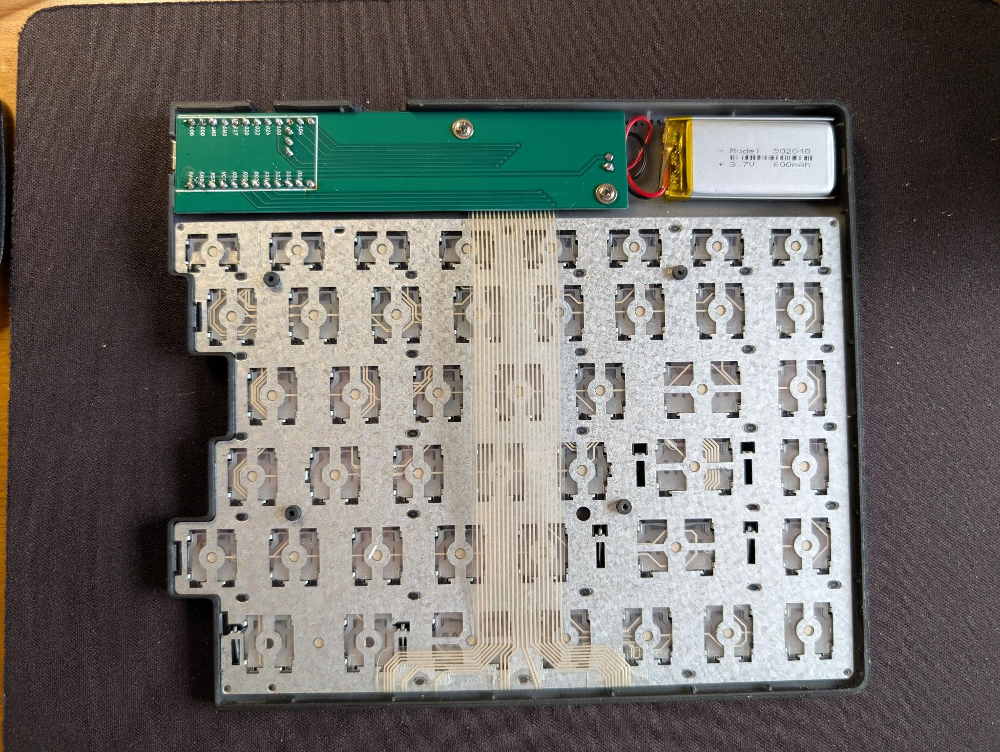
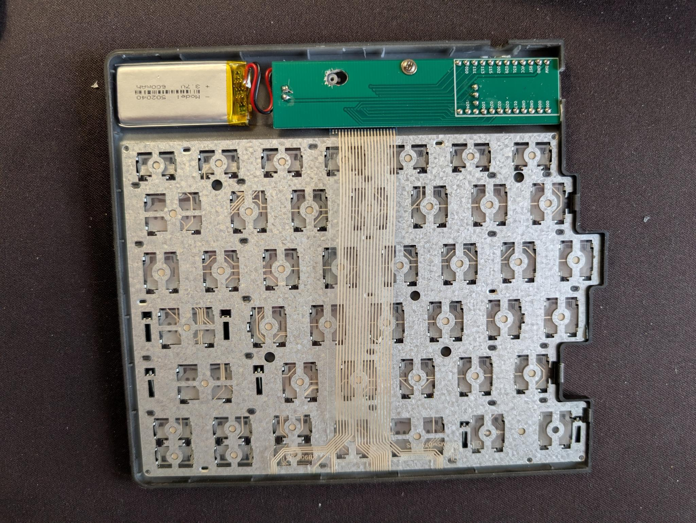
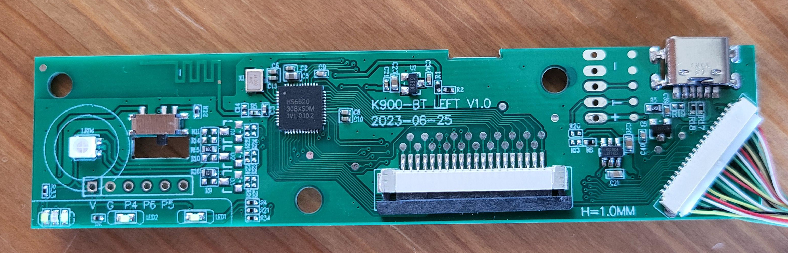
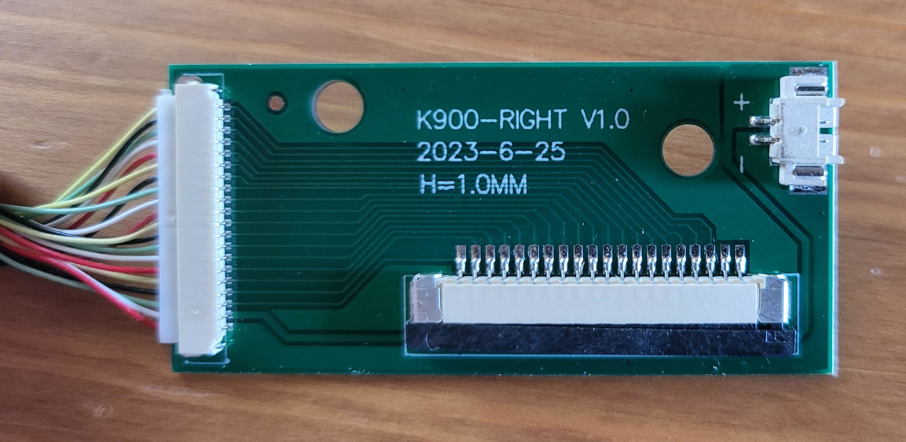
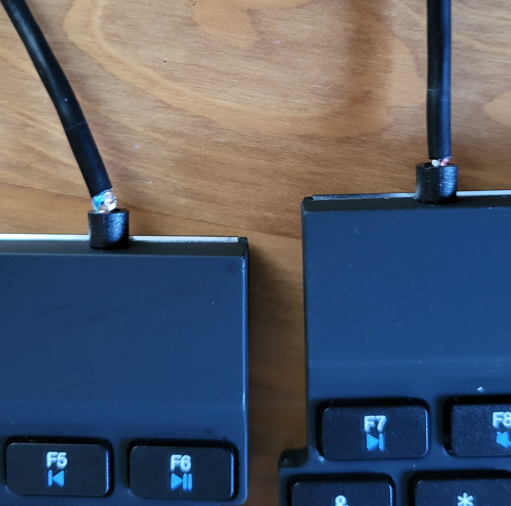
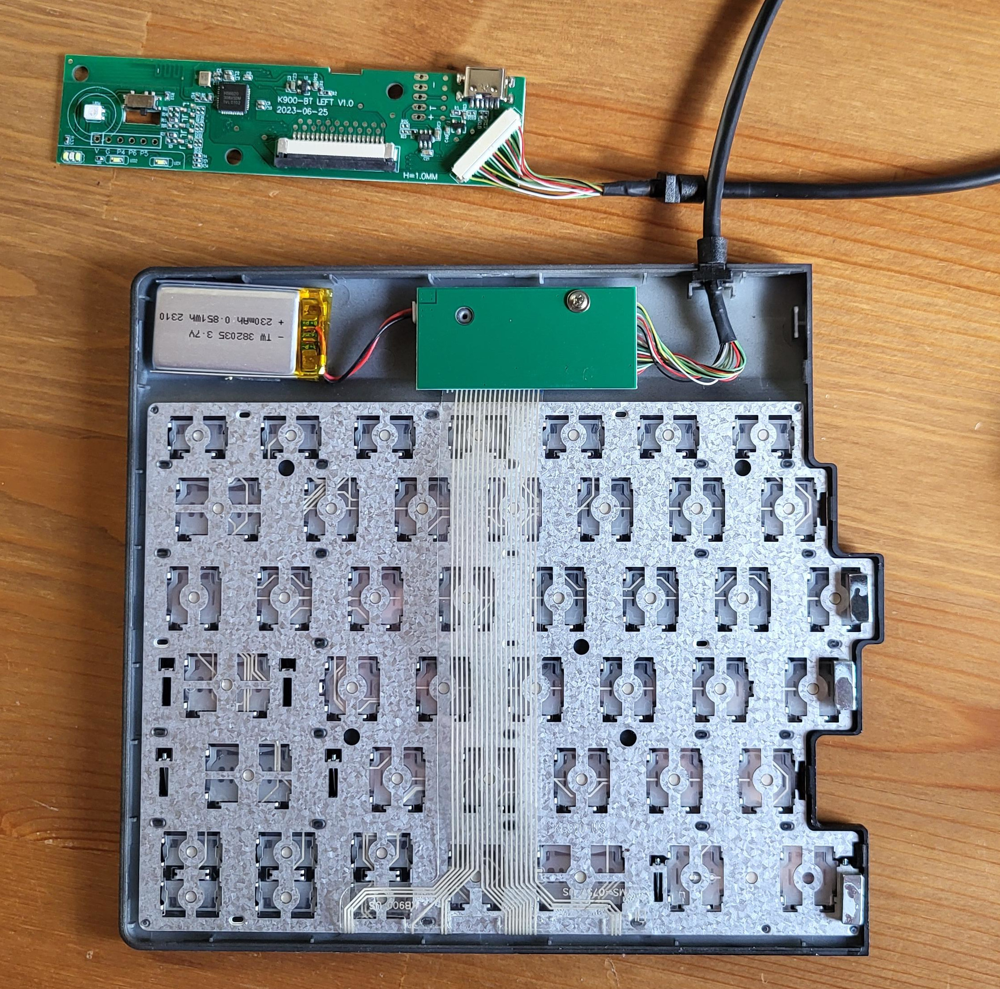
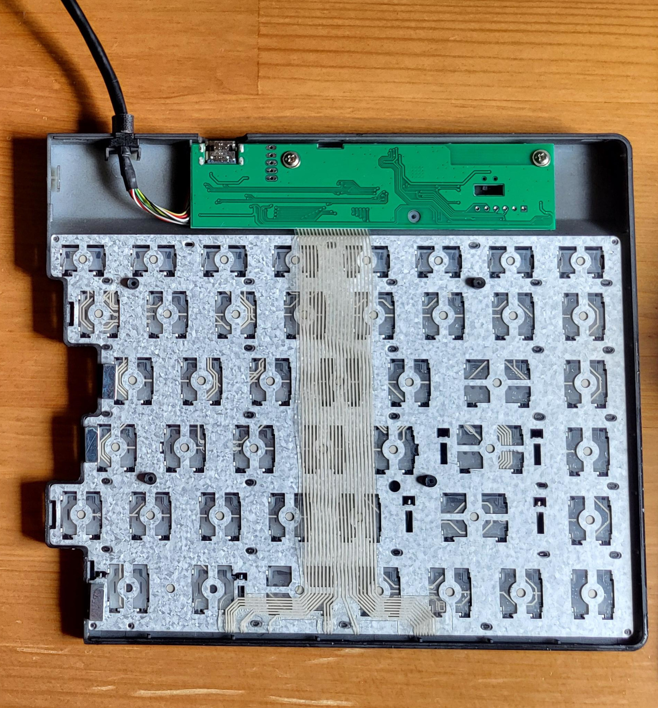
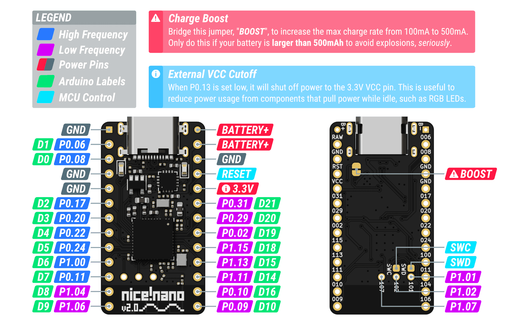

# R-Go split keyboard, converted to fully wireless with nice!nano + ZMK

This is a hardware and firmware mod of the commercially available R-Go split wireless keyboard. The stock electronics are replaced with a [nice!nano v2](https://nicekeyboards.com/nice-nano/) in each half, running [ZMK](https://zmk.dev/) firmware. The result is a truly wireless split, with no cable between the halves and fully programmable keys.

<p align="center">
  
  
</p>
<p align="center"><i>Both halves after the mod: a custom adapter PCB plugs into the stock membrane ribbon, with a nice!nano and its own 600 mAh battery on each side.</i></p>


## Why

The R-Go is the best low-profile, non-mechanical split keyboard I've found: thin, compact and comfortable. The stock version has some annoying limitations though:

- **The halves are joined by a hardwired cable**, even on the "wireless" model. Only the connection to the PC is Bluetooth. The cable is also poorly made: a light tug pulls the outer insulation off and exposes the conductors.
- **No real remapping.** The halves of the split spacebar can't be mapped separately, and important keys like Print Screen hide behind Fn.
- **The macro column** on the far left triggers key combinations internally, and a whole key is spent on disabling it.
- **USB is power-only**, so the keyboard can't work over a cable, for example in the BIOS or boot menu.
- **A tiny 230 mAh battery**, even though the case has plenty of room for a bigger one.

ZMK on a nice!nano fixes all of this: every key is programmable, both halves are wireless, and USB works for typing and flashing.


## The stock hardware

<p align="center">
  
</p>

- **Left half (control board `K900-BT LEFT V1.0`, 2023-06-25):** 100 × 24 × 1 mm with an HS6620 Bluetooth SoC (from HunterSun, now OnMicro), the kind of chip used in cheap smartwatches. Its SDK is only available under NDA, so reflashing the stock board isn't realistic. There's [a datasheet on archive.org](https://archive.org/details/hs6620d-data-sheet-v30/mode/2up) and [some reverse-engineering work](https://github.com/rbaron/HS6620D-smartwatch-reveng).
- **Right half (`K900-RIGHT V1.0`):** a passive board with only connectors, plus the 230 mAh battery (TW 382035). All of the right half's rows and columns, plus battery power, go to the left half over the 20-wire cable.
- **Key matrix:** a membrane with a flat ribbon cable (FFC) in each half. It's 1.0 mm pitch and about 21 mm wide, with a blue stiffener, and plugs into a bottom-contact ZIF connector. The left ribbon uses all 20 pins, the right one 18.

<p align="center">
  
  
</p>
<p align="center">
  
  
</p>


## The mod

Each half gets an adapter PCB with:
- a 20-pin, 1.0 mm FFC connector (TE 2-84952-0) for the stock membrane ribbon
- a nice!nano v2 footprint
- a 2-pin battery header, here for a 600 mAh 502040 LiPo, a big upgrade over the stock 230 mAh

The KiCad project, Gerbers and ready-to-order zips (`rgo_nicenano_left.zip`, `rgo_nicenano_right.zip`) are in [`rgo_nice!nano/`](rgo_nice!nano/). The PCBs reuse the stock mounting holes, and the inter-half cable is removed entirely.

Fitting notes:
- The case's inner space is about 6 mm deep and 21 mm tall in the flat part. The usable length is about 150 mm in the left half and 135 mm in the right half.
- The nice!nano fits inside easily, but it doesn't line up with the stock USB-C cutout because of the angle. The right half has no cutout at all, so expect to cut new openings.
- Socket headers are too tall for the space, even Mill-Max "super low profile" at 4 mm.

<p align="center"></p>


### Opening the case

Push a sharp piece of plastic, such as a plastic razor blade, into the seam. Each half has three clips on each flat side and four on the jagged side. Start with the flat sides.

The magnets tend to pop out because the glue is weak. You can glue them back in, but check the polarity so they attract instead of repel.

> **Wired vs. wireless:** The cheaper **wired** R-Go split also works as a base for this mod, since the matrix and ribbon are the same idea. But it has a hidden screw underneath the glued panels, which is quite annoying to get out.


## Firmware

The ZMK config is in [`config/boards/shields/rgo/`](config/boards/shields/rgo/), set up as a split shield (`rgo_left` / `rgo_right`) on `nice_nano_v2`. The left half is the central.

The membrane matrix (8 rows × 12 columns on the left, 8 × 10 on the right) was reverse-engineered with the `reverse_engineer_key_matrix*.py` and `capture_keys.py` scripts. They flash a test keymap that gives every matrix position a unique keycode, then record which key on the board produces which code. The resulting mapping is the `matrix-transform` in `rgo.dtsi`.

Keymap highlights (`rgo.keymap`):
- **Fn layer:** Bluetooth profiles, bootloader (left: Fn+1, right: the key labeled RCtrl +7), soft-off, media keys, Print Screen, Insert and more.
- **Unicode** via [zmk-unicode](https://github.com/urob/zmk-unicode), using WinCompose.
- **Recorded macros** on the far-left column (see below).


### Recorded macros

The six keys of the far-left macro column are record-and-play slots, stored in the keyboard's flash so they survive reboots and reflashing.

- **Record:** Fn + slot key, type the sequence, then Fn + slot key again to stop and save. Use the right Fn for the top two keys, because the left Fn shares their matrix column. Keys aren't sent to the computer while recording, so the keyboard seems dead until you stop.
- **Play:** slot key alone.
- **Erase:** record an empty sequence (Fn + slot key twice). `settings_reset` also erases them.
- Up to 64 keystrokes per slot.
- Only the left half needs reflashing for changes here, since it does all the recording.

The code is in `recmac/`, a small Zephyr module that `zephyr/module.yml` at the repo root makes the build pick up. Settings like max length and playback speed are in `recmac/Kconfig`.


## Building the firmware

### Easiest: GitHub Actions (no local toolchain needed)

Every push to GitHub builds the firmware in the cloud. Three files drive it:
- `.github/workflows/build.yml` runs ZMK's reusable build workflow, pinned to v0.3.
- `build.yaml` lists which board/shield combos to build: left, right and settings_reset.
- `config/west.yml` sets which ZMK version and modules (zmk-unicode) to build against.

To get firmware:
1. Push, or on GitHub go to the Actions tab, pick the workflow and click "Run workflow".
2. Open the finished run in the Actions tab and download the `firmware` zip at the bottom.
3. Unzip, put a half into bootloader mode, and copy its `.uf2` onto the drive that appears.

To upgrade ZMK later, bump `revision` for both zmk and zmk-unicode in `config/west.yml`, and the `@v0.3` in the workflow. v0.4+ is Zephyr 4.1, where the board becomes `nice_nano//zmk` in `build.yaml`.


### tl;dr: local build and flash when the environment is already set up

Put the keyboard into bootloader mode (left half: Fn-1, right half: RCtrl-7), then in cmd.exe:
```
set PATH=%PATH%;"C:\Users\t\anaconda3\Scripts";"C:\QMK_MSYS\mingw64\bin"
subst Q: "C:\Users\t\Proton Drive\My files\github\rgo_wireless"
cd desktop\zmk\app
west build -d build/left -p -b nice_nano_v2 -- -DSHIELD=rgo_left -DZMK_CONFIG="Q:/config" -DZMK_EXTRA_MODULES="Q:/zmk-unicode;Q:/"
copy build\left\zephyr\zmk.uf2 G:\zmk.uf2
```


### Setting up a local build on Windows

You need to clone zmk. It isn't in this repo because it's 4 GB.

```
pip install west
set PATH=%PATH%;"C:\Users\t\anaconda3\Scripts";"C:\QMK_MSYS\mingw64\bin"

git clone https://github.com/zmkfirmware/zmk zmk
cd zmk
git checkout v0.3
west init -l app/
west update
west zephyr-export
```

From elevated powershell:
```
choco install cmake ninja dtc-msys2 gperf
```

```
pip install -r zephyr/scripts/requirements-base.txt
```

```
cd %HOMEPATH%
wget https://github.com/zephyrproject-rtos/sdk-ng/releases/download/v0.16.3/zephyr-sdk-0.16.3_windows-x86_64.7z
7z x zephyr-sdk-0.16.3_windows-x86_64.7z
cd zephyr-sdk-0.16.3
setup.cmd
```

To build, you need to be in the zmk/app folder:
```
cd desktop\zmk\app
```

The build command has to point to this repo's config directory, but west can't handle spaces in paths, even quoted. I use subst as a workaround on Windows:

```
subst Q: "C:\Users\t\Proton Drive\My files\github\rgo_wireless"
```

For a split build:
```
west build -d build/left -p -b nice_nano_v2 -- -DSHIELD=rgo_left -DZMK_CONFIG="Q:/config" -DZMK_EXTRA_MODULES="Q:/zmk-unicode;Q:/"
```
```
west build -d build/right -p -b nice_nano_v2 -- -DSHIELD=rgo_right -DZMK_CONFIG="Q:/config" -DZMK_EXTRA_MODULES="Q:/zmk-unicode;Q:/"
```

Put the left side into bootloader mode, then:
```
copy build\left\zephyr\zmk.uf2 E:\zmk.uf2
```

Put the right side into bootloader mode, then:
```
copy build\right\zephyr\zmk.uf2 E:\zmk.uf2
```

Sometimes you need to "reset" the keyboard by clearing the non-volatile memory. This firmware doesn't go back into bootloader mode afterwards until you reset or power-cycle it.
```
west build -d build/reset -p -b nice_nano_v2 -- -DSHIELD=settings_reset
```

ZMK overrides some config settings when it detects a split keyboard, which it seems to do from the `_left`/`_right` suffixes on the config file names. The only way to override that is a command-line option. For example, to connect the two halves to the computer separately, build with:
```
-DCONFIG_ZMK_SPLIT=n
```

`config/west.yml` and `build.yaml` are only used by the GitHub Actions build; local builds ignore them.


## Repo layout

| Path | What |
|---|---|
| `config/boards/shields/rgo/` | ZMK shield: matrix pins, matrix transform, keymap, Kconfig |
| `recmac/`, `zephyr/module.yml` | Record-and-play macro behavior (Zephyr module) |
| `rgo_nice!nano/` | KiCad project and Gerbers for the adapter PCBs |
| `nice-nano-kicad/` | nice!nano KiCad footprint (submodule) |
| `nice-nano-v2-1.snapshot.2/` | nice!nano v2 3D model, for checking fit |
| `pics/` | Photos, plus `dimensions.pptx` with case measurements |
| `reverse_engineer_key_matrix*.py`, `capture_keys.py` | Scripts used to map the membrane matrix |
| `rgo_keyboard.txt` | Raw teardown notes |
| `zmk-unicode/` | Unicode module (submodule, for local builds) |
